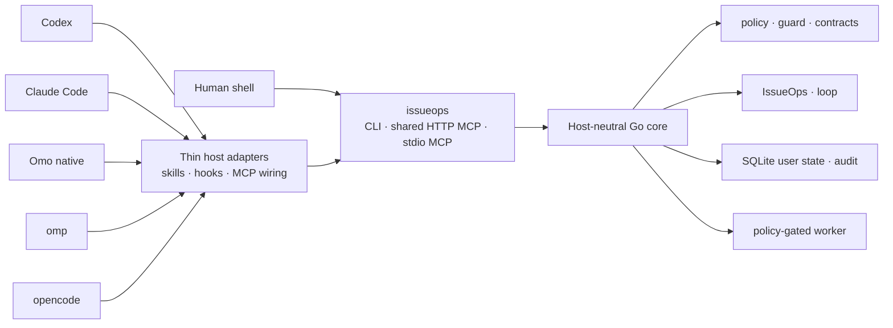

<h1 align="center">IssueOps</h1>

<p align="center">
  <strong>Team memory for coding agents, shipped in the same PR as the code</strong><br />
  Pitfalls and decisions one person's agent learns are recorded in the repository,<br />
  and a teammate's agent reads them before the next related task
</p>

<p align="center">
  <a href="README.md">한국어</a>
  ·
  <a href="README.en.md"><strong>English</strong></a>
</p>

<p align="center">
  
</p>

## What it solves

Working with coding agents produces pitfalls that took real time to find and
decisions made after weighing alternatives. That knowledge usually stays in one
person's chat history, so a teammate's agent walks into the same pitfall and
proposes the alternative that was already rejected.

IssueOps is a local Go harness that writes this knowledge into the repository as
cautions (a pitfall and how it was resolved) and ADRs (design decision records).
Records are written inside a cycle that takes one issue through **issue → plan →
implement → verify → PR/MR → cleanup**, so they land in the same PR as the code
change and are reviewed with it. A plan without its applied decisions and
cautions section does not pass, and the PR cannot be published until the docs
verdict is recorded.

IssueOps currently ships Korean-language skills and templates. Required plan
headings and issue/PR body sections are Korean, and `link-plan` matches the
headings verbatim, so the issues and PRs it writes carry Korean section titles.

[How team knowledge carries over](#how-team-knowledge-carries-over) ·
[What the issue does](#what-the-issue-does) ·
[What else the cycle handles](#what-else-the-cycle-handles) · [Quick start](#quick-start) ·
[Basic workflow](#basic-workflow) · [Architecture](#architecture) ·
[Troubleshooting](#troubleshooting)

## How team knowledge carries over

When an agent hits a pitfall it writes a caution, and when it makes a decision it
writes an ADR, one record each under `.issueops/cautions/` and `.issueops/adr/`.
Records are plain Markdown, so they are committed with the code and reviewed in
the PR. Once a teammate pulls them, every host (Codex, Claude Code, Omo native,
omp, or opencode) reads the same records. The image at the top shows this flow. Two steps
are not in it: the teammate's agent reads only the records `route-docs` picks
for the task, not all of them, and what that task teaches becomes new records in
turn, so the records grow with every task.

### A real record and lookup

This repository is developed the same way, with its records in
[`.issueops/cautions/`](.issueops/cautions/) and [`.issueops/adr/`](.issueops/adr/).
Take one caution:
[`2026-08-28-gitlab-workitem-labels-...`](.issueops/cautions/2026-08-28-gitlab-workitem-labels-assignees-selection-create-child-glab.md)
records that GitLab WorkItem exposes labels and assignees only through widgets,
so `remote create-child` failed, while a fake `glab` stub echoed the wrong response
shape and kept the tests green. Its `Summary`, `Context`, `Resolution`, and
`Evidence` fields say what broke, why, and how it was fixed. This repository
writes its records in Korean.

A later task that touches GitLab child issues gets this record from
`route-docs`. Below is that entry from the real output's `docs` array, with only
the absolute `path` field removed:

```bash
io project route-docs --repo . --task "gitlab child issue labels" --json
```

```json
{
  "rel_path": ".issueops/cautions/2026-08-28-gitlab-workitem-labels-assignees-selection-create-child-glab.md",
  "reason": "past record \"GitLab WorkItem 직속 labels/assignees selection이 create-child를 막았고 가짜 glab 스텁이 그 오류를 감췄다\" shares: child, gitlab, label",
  "exists": true
}
```

### Gates that keep records from being skipped

Writing records and finding them again are not left to memory.

| When | Mechanism | What it does |
|---|---|---|
| Record | `project append` (MCP `project_docs_append`) | Adds one dated record under `.issueops/cautions/` or `.issueops/adr/` |
| Start | `project route-docs` (MCP `project_docs_route`) | Returns up to five past records sharing at least two terms with the task, with the shared terms |
| Plan | `link-plan` gate | Refuses a plan without the `## 적용되는 결정과 주의사항` (applied decisions and cautions) section |
| Docs stage (6) | `project-docs-review record` gate | Binds the docs verdict, updated or reviewed with no change, to the change-set fingerprint |

The `issueops-plan` skill reads the documents route-docs picked and writes the
decisions and cautions that apply to this task into that section. If the diff
changes after the docs verdict, the verdict goes stale and the cycle returns to
stage 6. Details are in
[How the operating docs are enforced](#how-the-operating-docs-are-enforced).

`route-docs` picks records by shared terms, not semantic search. The output shows
the shared terms behind each pick, but the task text has to name the files and
operations you are about to touch for the right records to surface. IssueOps does
not detect a record that has drifted from the code; stale records are fixed by
people at the docs stage or in PR review.

### How this differs from `AGENTS.md` and agent memory

|  | `AGENTS.md` / `CLAUDE.md` | Built-in agent memory | IssueOps records |
|---|---|---|---|
| Who writes it | A person, by hand | The agent, from your conversations | The agent, reviewed by people in the PR |
| Where it lives | One file in the repository | Each person's machine | `.issueops/` in the repository, one file per record |
| Reaches teammates | Through git | No | Through git |
| What the agent reads | The whole file at session start | Whatever the tool picks | Only records related to the task |
| When it gets written | When someone remembers | When the tool decides | As soon as it is learned, at the latest at the docs stage |

The built-in memory column follows Claude Code's auto memory, which the
[Claude Code docs](https://code.claude.com/docs/en/memory) describe as
machine-local and not shared across machines. The same docs recommend keeping a
`CLAUDE.md` under 200 lines, because longer files consume more context and reduce
adherence.

IssueOps does not replace `AGENTS.md`. Bootstrap adds a document routing block to
it, and repository-wide rules still live in `AGENTS.md` and the `.issueops/`
operating docs. Rules every session needs stay in `AGENTS.md`; pitfalls and
decisions that matter only for some tasks become records.

### Without a cycle

Once a repository is bootstrapped (see
[Connect project docs to a repository](#connect-project-docs-to-a-repository)),
recording and routing work on their own:

```bash
io project append --repo . --kind caution \
  --title "Stripe webhook retries reuse the event id" \
  --summary "Deduplicate webhook handling by event id" --json
git add .issueops && git commit -m "docs: record webhook caution"

# in a teammate's checkout
io project route-docs --repo . --task "fix payment webhook retry handling" --json
```

### What the team shares and what stays local

| Scope | What | Where |
|---|---|---|
| Shared by the team | Operating docs, caution and ADR records | The repository's `AGENTS.md` and `.issueops/`, shared through git |
| Local to each person | Cycle state, verification evidence | The SQLite store under `~/.local/state/issueops/` |
| Local to each person | Skill links, MCP and hook config | Host configuration under your home, created at install |

## What the issue does

The Issue in IssueOps is the issue as the unit of work. One cycle starts from one
issue, and its branch, plan, PR, and post-merge report are all tied to that issue
number. Caution and ADR records keep what was learned; the issue keeps what the
work set out to do and how far it got.

| When | What ties to the issue |
|---|---|
| Start | `issueops-create-issue` settles the requirements through research and blocking questions, then creates the issue. An implementation issue body needs the `요약` (summary), `배경` (background), `완료 기준` (acceptance), `범위` (scope), and `검증` (verification) sections |
| Branch | Named `<issue number>-<slug>`. GitHub links it to the issue as a linked branch; GitLab links it through the naming rule |
| Plan | The plan review's progress shows as one line in a managed region of the issue body |
| Implement | Tracked copies of the plan, architecture, intent, spec, and plan review (`plan.md`, `architecture.md`, `intent.md`, `spec.md`, `plan-review.md`) are committed to `.issueops/issues/<n>/`; the spec and plan-review copies exist only when those materials do |
| Publish | The PR comes from the issue-linked branch and carries the caution and ADR records with the code |
| After merge | A human-written progress report is reflected into the issue body and the issue is closed |

The issue body is a document for teammates, so it leads with a summary and stays
short. Hashes, full plan texts, and other implementation materials stay out of
it and live in `.issueops/issues/<n>/`
([related ADR](.issueops/adr/2026-09-24-issue-and-pr-bodies-are-human-documents.md)).
When a record's `Source:` line names the issue, as that ADR's
`Source: IssueOps #513` does, a teammate can trace a record back to its issue and
from there to the plan in `.issueops/issues/<n>/`.

Large work splits into child issues. Each child runs its own cycle, and the
parent cycle accepts (`child accept`) or rejects (`child reject`) the result.

## What else the cycle handles

The same cycle follows one execution contract whichever host picks it up: Codex,
Claude Code, Omo native, omp, or opencode. A human shell and several agents share the same
Go core, CLI/MCP contract, command policy, and skill source tree, and workflow
state and verification evidence stay in a local store outside the host. IssueOps
does not replace a host and does not approve work on its own. It binds the issue,
branch, plan, execution lease, verification evidence, and PR/MR into one durable
cycle state, so any session that picks the work up gets the same answer.

| Capability | What it provides |
|---|---|
| Cross-host integration | Codex, Claude Code, Omo native, omp, and opencode share one core and one response contract |
| CLI and MCP | The human-facing CLI and the agent-facing MCP share one core and one SQLite state. MCP runs as one shared local HTTP service per user by default; `--mcp-transport=stdio` runs it inside each host session |
| IssueOps cycle | Durable state from issue through plan, worktree, implementation, doc reflection, verification, PR/MR, and cleanup |
| Project docs | Creates, routes, and incrementally refreshes `AGENTS.md` and `.issueops/`, and enforces reflection through cycle gates |
| Execution safety | Workspace/cwd boundaries, write/network intent, timeout, redaction, and executable-fence policy |
| Verification and improvement | Contract, quality, self-verify, self-augment, and benchmark evidence in one model |
| Shared skills | One `skills/` tree linked into the user-level skill path of every host |
| UI/UX and browser QA | `ui-ux-craft` plus Aside-based QA skills; Aside is an optional, separately installed tool |

PR/MR publication, merge, and cleanup are separate stages. The agent works up to
the endpoint you asked for and never merges or deletes on its own when you asked
only for publication.

### How the operating docs are enforced

IssueOps splits its rules into three layers. Where a rule goes depends on what a
mistake would cost.

| Layer | What lives here | Example |
|---|---|---|
| Context (hook) | Static information a session needs. Reads and writes no state | `SessionStart` and `SubagentStart` inject the `.issueops/` document catalog |
| Procedure (skill) | Ordering and criteria that need judgment. Review catches violations | Read CONSTITUTION, CAUTIONS, and ADR before planning and record them under `## 적용되는 결정과 주의사항` |
| Gate (CLI) | Violations block the next stage. Sealed into the cycle state by fingerprint | The required-section checks in `architecture review` and `link-plan`, the `project_docs_review` publication gate |

These gates exist in the CLI for the operating docs:

- `issueops architecture review` records an approval only when the architecture
  document has all five sections, `## 요구사항과 규모`, `## 데이터와 API 계약`,
  `## 구조와 흐름`, `## 병목과 장애`, and `## 절충점과 기각한 대안`, each with a
  non-empty body. The approval is bound to the document's sha256, so editing it
  afterwards turns it into `architecture_review_stale` and the cycle cannot move on
  to writing the plan until it is approved again.
- `issueops link-plan` refuses a plan that lacks any of the four sections
  `## 적용되는 결정과 주의사항`, `## 재사용하는 기존 구현`, `## 성능 영향`, and
  `## 하위 호환성과 side effect`.
- `issueops project-docs-review record` is the stage 6 verdict. `--verdict updated`
  requires every `--doc` path to be in the actual change set, and
  `--verdict no-change` requires at least one existing `--reviewed-doc` path, under
  `.issueops/` or `AGENTS.md`, that was actually read. The verdict is bound to the
  change-set fingerprint, so a later diff turns it into `project_docs_review_stale`
  and `next` returns the cycle to stage 6.
- The gate applies to every cycle from implement onward, with or without an
  execution lease.
- `issueops devils-advocate review` accepts at most five unwaived `revise` verdicts
  per plan phase. The sixth is refused, and the error names the exits that are
  actually open: record `stop`, reflect it, then `regress`, or take the round with
  an explicit waiver.

Hooks carry no enforcement. The 2026-08-27 decision removed every legacy
enforcement hook, and a hook that announces the stage was rejected because it
would put stage detection in two places. The rationale is in
[`.issueops/ADR.md`](.issueops/ADR.md).

## Quick start

You need Git, Go 1.26.6 or later, and at least one host you plan to use (Codex,
Claude Code, Omo native, omp, or opencode). There is no public binary release yet, so you
build from source (`v0.1.0` is a draft). To write issues or PRs/MRs on GitHub or
GitLab, also set up and authenticate that provider's CLI (`gh` or `glab`).
Herdr and Aside for browser QA are optional integrations installed separately.

```bash
git clone https://github.com/m16khb-org/issueops.git
cd issueops

./install.sh --dry-run --json
./install.sh

./bin/issueops inspect --json
./bin/issueops doctor --repo . --json
```

> [!IMPORTANT]
> issueops 0.1.0 is an actively developed local tool. The default install
> updates host configuration under your home directory and the command shim in
> `~/.local/bin`. Review the full plan with `./install.sh --dry-run --json`
> before applying it.

The installer builds the local binary and refreshes the host integration under
your home directory. It writes nothing into a target repository unless you ask
for it explicitly. If `io` is not found after install, open a new shell or
refresh the shell's command cache. `issueops` is the canonical command and `io`
is a short symlink the installer manages. If a different file already carries
one of those names, the installer stops instead of overwriting it.

### Host integrations

The default installer wires every host adapter into the same execution contract.

| Target | Default location and role |
|---|---|
| Codex | `~/.codex/skills/`, MCP config, `SessionStart` and `SubagentStart` hooks |
| Claude Code | `~/.claude/skills/`, user-scope MCP, `SessionStart` and `SubagentStart` hooks |
| Omo native | `~/.omo/agent/skills/`, `~/.omo/mcp.json`, lifecycle extension |
| omp | `~/.omp/agent/skills/`, `~/.omp/agent/mcp.json`, `~/.omp/agent/extensions/issueops.js` |
| opencode | `~/.config/opencode/skills/`, `mcp.servers.issueops` in `~/.config/opencode/opencode.json`, `~/.config/opencode/plugins/issueops.js` (follows `XDG_CONFIG_HOME`); only an `opencode --standalone` session can hold a lease |
| agy (Antigravity CLI) | `~/.gemini/config/skills/`, `~/.gemini/config/mcp_config.json`; always stdio, no hooks |
| MCP service | macOS LaunchAgent `io.issueops.mcp` or Linux systemd user `issueops-mcp.service`; Codex, Claude Code, Omo native, omp, and opencode share `http://127.0.0.1:47831/mcp` |
| Runtime state | SQLite store under `~/.local/state/issueops/`; isolate it with `ISSUEOPS_STATE_DIR` |
| Project knowledge | `AGENTS.md` and `.issueops/` in the target repository, created only by an explicit project bootstrap |

Skills are linked, not copied, from this checkout's `skills/`, so keep the
checkout after install. The default install changes only the user's home and
never creates repo-local skill links or hook registrations.

On macOS and Linux the default MCP connection is the shared HTTP service
(`--mcp-transport=http`). The installer creates a bearer token at
`~/.local/state/issueops/mcp-http/bearer`, rewrites only the issueops entry of
each host config to the URL plus an `Authorization` header, and sets the files to
mode 0600. To run `issueops mcp` inside each host session instead, install with
`./install.sh --mcp-transport=stdio`. Check the service with
`io mcp service status --json`. A session that calls workspace tools over HTTP
first gets an authority file from `io mcp authorize --workspace-root <repo> ...`
and passes its path as `authority_file`. Processes of the same OS user can read
these files, so the trust boundary is the OS user.

`install` accepts `--interactive`, `--project-local`, and
`--path-mode=auto|manual|skip`; `bootstrap` adds `--sync`. `--project-local`
writes `.mcp.json`, `.omo/mcp.json`, `.omp/mcp.json`, and `.opencode/opencode.json` only with
`--mcp-transport=stdio`; with the default HTTP transport those hosts keep the
user-scope entry. agy's `.agents/mcp_config.json` is written either way, and
skill links always stay in your home. After native activation, `install` and
`update` optionally provision the Claude plugins and Git skills declared in
[`configs/upstream.json`](configs/upstream.json). A network failure in that step
is reported but does not fail the install.

### Update

To refresh an install after updating the checkout, use `io update`. It builds the
checkout and refreshes the user-level integration. It picks the checkout from
`ISSUEOPS_ROOT`, then the checkout found by walking up from the current
directory, then the one the installed command points to, so running it inside
another IssueOps checkout builds that checkout. It never runs `git pull`.

```bash
git pull --ff-only
io update --dry-run --json
io update --json
io inspect --json
```

With the HTTP transport, `io update` stops the MCP service, restarts it on the new
binary, and checks its `build_id`. Hosts pick up MCP changes when they reconnect,
so reconnect MCP if old tools still show after an update.

## Basic workflow

### Connect project docs to a repository

Review the plan first, then create the `AGENTS.md` routing block and the
`.issueops/` document family. Existing documents are never overwritten wholesale.

```bash
issueops project bootstrap --repo . --dry-run --json
issueops project bootstrap --repo . --json
issueops project route-docs --repo . --task "fix login session expiry in auth middleware" --json
```

Initial creation belongs to `project-docs-bootstrap`, incremental refresh during
work to `project-docs-update`, and restructuring of oversized documents to
`project-docs-optimize`. Commit the generated `AGENTS.md` and `.issueops/` so
teammates receive the same docs and records.

### Check daily health

```bash
io status --json
io doctor --repo . --json
io docs --json
```

`doctor` diagnoses install, state, hooks, MCP, and project docs in one
pass. `status` is the daily summary; `inspect` is the detailed projection of the
install and native integration.

### Start an IssueOps cycle

Ask your agent to use the `issueops` skill, and tell it the outcome, the
constraints, and how far to go. For example:

> Use issueops to fix the login error. Reproduce it with an expired session and
> add a test. Go as far as opening a draft PR.

Whatever stage you are in, ask `next` first. The command is read-only and uses
only the local cycle state and local observation.

```bash
issueops next --json
```

```text
stage 3/10 plan.review  cycle io-xxxx  phase plan  lease active(gen 1, self)
missing: devils_advocate_review
next: issueops devils-advocate review --id io-xxxx --reviewer-context subagent ...
exits: pause=issueops execution release --id io-xxxx --generation 1 ... abandon=issueops cleanup abandon --id io-xxxx --reason <TEXT> --preview takeover=-
```

When no cycle exists, `next` returns `issueops start`.

```bash
issueops start --repo "$PWD" --branch "123-short-description" --json
```

`start --new` creates a new branchless cycle on every call, so do not repeat it
when a response is unclear. Remote issue, PR/MR creation, and cleanup default to
preview or dry-run. External mutation requires an explicit `--confirm` plus the
fingerprint and actor contract, and an ambiguous result is settled by
`remote reconcile-issue` or `remote reconcile-child`, which confirm exactly one
outcome instead of retrying.

## The ten stages

The user sees ten stages, each owned by one or two skills. Only `issueops next`
decides which stage a cycle is in, so every host gets the same answer.

| Stage | Skill | What it does |
|---|---|---|
| 1 Confirm and create the issue | `issueops-create-issue` | Settles the contract through research and blocking questions, then creates the issue |
| 2 Prepare the branch | `issueops-prepare` | Seals the base SHA and links the branch to the issue |
| 3 Read docs, approve the architecture, plan, review, hand off | `issueops-plan` | Reads the operating docs and related caution and ADR records, gets the architecture document approved by an independent review, writes the plan on top of it, passes review, and picks the execution session automatically |
| 4 Implement | `issueops-implement` | Implements with TDD in the canonical worktree |
| 5 Clean AI slop | `issueops-slop-clean` | Removes residue and seals the change set |
| 6 Reflect into project docs | `issueops-docs` | Records decisions and pitfalls in the operating docs and reseals |
| 7 Verify | `issueops-verify` | Re-runs verification, review, and readiness without touching files |
| 8 Commit and push | `atomic-commit-push` | Commits and pushes the sealed change |
| 9 Publish the PR/MR and complete | `issueops-create-pr`, `issueops-complete` | Creates the draft and seals the completion evidence |
| 10 Merge and clean up | `issueops-merge`, `issueops-cleanup` | Merges the PR/MR, reflects the result into the issue, closes it, and reclaims the worktree and branch |

Leaving a cycle from any stage belongs to `issueops-abandon`. Procedures shared
by several stages live in `issueops-review` (adversarial review), `gates-ledger`
(gate ledgers), and `issueops-remote-write` (the remote write protocol). A branch
cut from a base that keeps advancing, such as a release branch, catches up with
the `sync-base` skill; a branch an IssueOps cycle owns uses
`issueops execution sync-base` instead.

The durable phase enum is below. Issue linkage happens before `plan` and cleanup
runs after `done`; neither is a phase.

```text
problem → grill → plan → compatibility-review → implement
        → ai-slop-clean → feedback → pr → done
```

## Models and session handoff

A normal cycle asks nothing about where to run. After the branch and worktree
are prepared, it checks Herdr. If the preparing session runs inside Herdr and a
running server, a compatible version, and a runnable current native host are
confirmed, the work hands off to a new Herdr session in the same worktree.
If Herdr is unavailable, the work continues in the current session, or you hand
it off by hand from a second terminal you open yourself. An installed binary
alone does not count as ready, and IssueOps neither installs a launcher nor
starts a server. cmux is used only when you name it.
That choice decides only where the work runs; the original request's approved
scope and endpoint are unchanged, and an explicit instruction to hold or to use a
particular session wins over it.

All five hosts let you change the model and effort per role, for your whole user
(global) or one repository (local). Each field resolves explicit flag > local >
global > built-in default.

```bash
issueops model show --json                                   # current values and their sources
issueops model set --scope local --host codex --role diff-review --effort xhigh --json
issueops model resolve --host claude --role research --json  # final value and the empty-context argv
```

Built-in defaults per host, settings file locations, role subagents, and the
review-round escalation rule are in the
[execution guide](.issueops/operations/guides/issueops-execution.md#역할별-모델-기본값과-설정).
To change them in conversation, use the [`io-model`](skills/io-model/SKILL.md) skill.

Automatic handoff passes `--dangerously-skip-permissions` to Claude Code,
`--dangerously-bypass-approvals-and-sandbox` to Codex,
`--permission-preset full-access` to Omo native, and `--auto-approve` to omp,
and opens opencode with `opencode --standalone --auto`.
These skip the host's own permission prompts, so settle the scope of the handed-off
work first. IssueOps keeps its own lease, generation, workspace, and remote-write
checks. Acceptance of the handoff command and the actual claim and
completion are recorded as separate evidence.

## Architecture

<p align="center">
  
</p>



Five boundaries hold:

1. Core behavior lives in the Go core, never in a host plugin or hook.
2. CLI JSON and MCP responses keep the same meaning.
3. Host adapters never bypass authentication, command policy, or workspace boundaries.
4. Hooks only inject project-doc context at `SessionStart` and `SubagentStart`; they block no tool call and do no work on the agent's behalf.
5. The worker handles lifecycle jobs and policy-gated read-only evidence commands only.

## Command areas

| Area | Representative commands | Role |
|---|---|---|
| Install and update | `install`, `update`, `bootstrap`, `version` | Refresh the binary, skills, hooks, and MCP wiring; check the version |
| Diagnostics | `inspect`, `system-status`, `doctor`, `docs` | Inspect install, state, and project docs |
| Safety and quality | `policy`, `guard`, `quality`, `verify-work`, `trace`, `contract`, `api-doc`, `preflight` | Execution policy, change quality, evidence and public contract, pre-commit repository checks |
| Workflow | `start`, `next`, `status`, `execution`, `loop`, `gates`, `channel` | Durable IssueOps cycle (its lifecycle commands sit at the top level), completion gate ledgers, cross-session message channels |
| Docs and hooks | `project`, `hook` | Project doc creation, routing, and refresh; the `SessionStart` and `SubagentStart` context hook entry points |
| State and runtime | `state`, `mcp`, `worker` | User state, MCP server, limited local jobs |
| Models | `model` | Per-role model and effort settings: show, set, unset, resolve |
| Improvement and research | `self-verify`, `self-augment`, `web-fetch`, `review-metrics` | Harness verification, improvement candidates, resilient public web fetches, adversarial-review round and verdict metrics |

The full command and MCP tool contract comes from the built binary:
`issueops contract schema --json` lists every CLI command and MCP tool.

```bash
issueops --help
issueops contract schema --json
issueops contract check --json
```

## Skills

The shared skill source is [`skills/`](skills/). The installer points each
host's user-level skill path at this directory.

- Planning and critique: `implementation-planning`, `requirements-analysis`, `architecture-review`, `prompt-engineering`
- Execution and verification: `verified-execution`, `issueops-debugging`, `algorithm-optimization`, `database-schema-architecture`, `code-quality-metrics`
- Research and team work: `web-research`, `meeting-notes`, `slack-delegate`, `sharing-backend-work`, `explain`
- Git and operations: `git-operations`, `atomic-commit-push`, `sync-base`, `gitlab-usecase`. `sync-base` checks whether the commits already reached another branch and whether other authors or reviewers depend on them, then picks merge or rebase, falling back to merge when the evidence is unclear
- IssueOps stages: `issueops` (router), `issueops-create-issue`, `issueops-prepare`, `issueops-plan`, `issueops-implement`, `issueops-slop-clean`, `issueops-docs`, `issueops-verify`, `issueops-create-pr`, `issueops-complete`, `issueops-merge`, `issueops-cleanup`, `issueops-abandon`
- IssueOps shared: `issueops-review`, `gates-ledger`, `issueops-remote-write`, `issueops-sync-issue`, `issueops-sync-pr`
- Project docs: `project-bootstrap`, `project-docs-bootstrap`, `project-docs-update`, `project-docs-optimize`
- UI/UX and browser QA: `ui-ux-craft`, `aside-functional-qa`, `aside-visual-qa`, `aside-web-qa`, `read-public-artifact`. Of these, `ui-ux-craft` and `aside-web-qa` are reached from stages 4 and 7 when `next.review.frontend` is set; the other two QA skills are driven by that orchestrator, never called by the cycle directly
- Code review: `pr-review`, `review-agent-feedback`
- Operational improvement: `io-update`, `io-model`, `self-verify`, `self-augment`, `stability-audit`
- Korean writing and diagrams: `fluent-korean`, `diagram-design`

Each skill's contract lives in its `SKILL.md`. The twelve pioneer skills are
verified across primary, boundary, and operational cases; execution receipts and
semantic verdicts are under [`testdata/pioneer-holdouts/`](testdata/pioneer-holdouts/).

## Local data and safety boundaries

- The default install touches only host configuration under your home. A target repository changes only through an explicit bootstrap or a project-local opt-in.
- Runtime state lives in a SQLite store under `~/.local/state/issueops/` by default and can be isolated with `ISSUEOPS_STATE_DIR`.
- Remote writes follow explicit approval and each command's fingerprint and actor contract.
- Command execution is confined to the workspace root and cwd, with write/network/shell intent, timeout, and redaction managed by policy.
- MCP tool arguments are validated against the public schema; unknown fields and missing or wrongly typed fields are rejected.
- The executable shell fence checks syntax, failure swallowing, destructive commands, dynamic shell, and symlink escapes without running a shell.
- Raw secrets never land in docs, state responses, audit logs, or test fixtures.
- External tools are not dependencies of native install, readiness, or self-verification. Integrations such as Herdr are optional; IssueOps stays the durable authority.

## Repository map

```text
cmd/issueops/           composition root and CLI/MCP/hook entry points
internal/contract/      versioned DTOs shared by transports and stores
internal/domain/        pure rules, reducers, and classifiers with no I/O
internal/application/   use cases composing domain and ports
internal/port/          external capability interfaces and error contracts
internal/adapter/       host, filesystem, process, and DB boundary implementations
internal/architecture/  production import graph fitness tests
configs/                Codex, Claude Code, Omo native, omp, opencode, and agy templates plus upstream.json
skills/                 skill source shared by every host
.issueops/              architecture, operations, testing, ADR, and other project docs
scripts/                install, release, smoke, and validation scripts
docs/                   supporting documents and assets
```

## Verification

Run the minimum gate even for a docs-only change.

```bash
./bin/issueops contract check --json
./bin/issueops docs --json
./bin/issueops inspect --json
go test ./... -count=1
go build -o bin/issueops ./cmd/issueops
git diff --check
```

Add `go test -race ./... -count=1` when Go code or a public contract changed.
The harness quality gate is `self-verify`.

```bash
./bin/issueops self-verify --seed=100 --target-score=95 --llm-eval=false --json
./bin/issueops quality inspect --json
```

In `quality inspect`, `collection_status`, `health_status`, and `gate_status`
report whether collection succeeded, what was observed, and whether the gate
blocks. A collection failure fails closed as `gate=block`; non-blocking debt
such as low coverage stays `report_only`. Per-change standards are in
[`.issueops/TESTING.md`](.issueops/TESTING.md).

## Release and rollback

There is no public release yet (`v0.1.0` is a draft). The first release will ship
as tarball and manual archives, and Homebrew waits until the release gate is
verified. The release build matrix cross-builds `darwin/arm64`, `darwin/amd64`,
`linux/amd64`, and `linux/arm64`. Release verification and rollback change local
artifacts and the installed state, so read the
[release reproducibility and rollback criteria](.issueops/operations/release-reproducibility.md)
first. The README carries no destructive rollback commands.

## Troubleshooting

| Symptom | What to check |
|---|---|
| `io` not found after install | Open a new shell or refresh the command cache, and confirm `~/.local/bin` is on PATH |
| Install refused because `io`/`issueops` exists | Expected: the installer never overwrites another file. Find the conflicting path in `--dry-run --json` |
| New MCP tools missing in the host | Reopen the host session after `io update` and inspect the catalog and config with `io inspect --json` |
| MCP service looks unhealthy | Run `io doctor --repo . --json` and `io mcp service status` |
| `link-plan` rejects with `missing required sections` | Add the four stage 3 section titles verbatim. Merging or renaming them does not pass |
| `next` returns to stage 6 with `project_docs_review_stale` | The diff changed after the verdict. Re-check the docs, reseal, and record the verdict again |
| Handoff model or effort is unexpected | Check `io model show --json` for values and sources, any explicit override, and the review round |
| self-verify looks stuck | Add `--progress=jsonl` to see each step's heartbeat |
| Project docs are stale | Refresh one document at a time with `project-docs-update`; use `project-docs-optimize` for structural problems |

## Project docs

| Document | Purpose |
|---|---|
| [`AGENTS.md`](AGENTS.md) | Repository working rules and verification priority |
| [`.issueops/CONSTITUTION.md`](.issueops/CONSTITUTION.md) | Instruction hierarchy and safety principles |
| [`.issueops/ARCHITECTURE.md`](.issueops/ARCHITECTURE.md) | Component boundaries and responsibilities |
| [`.issueops/AGENT_WORKFLOW.md`](.issueops/AGENT_WORKFLOW.md) | Agent start, work, verification, and completion flow, plus the hook boundary |
| [`.issueops/OPERATIONS.md`](.issueops/OPERATIONS.md) | Install, host, CLI/MCP, and runtime operations map |
| [`.issueops/operations/guides/issueops-execution.md`](.issueops/operations/guides/issueops-execution.md) | Cycle, execution lease, handoff, recovery, and per-role models |
| [`.issueops/TESTING.md`](.issueops/TESTING.md) | Tests and verification gates |
| [`.issueops/ADR.md`](.issueops/ADR.md) | Structural decisions, rationale, and rejected alternatives |

Install and operations procedures are split into [install](.issueops/operations/install.md),
[hosts](.issueops/operations/guides/hosts.md), [CLI/MCP](.issueops/operations/guides/cli-and-mcp.md), and
[verification](.issueops/operations/verification.md).

## License

MIT. See [`LICENSE`](LICENSE).
