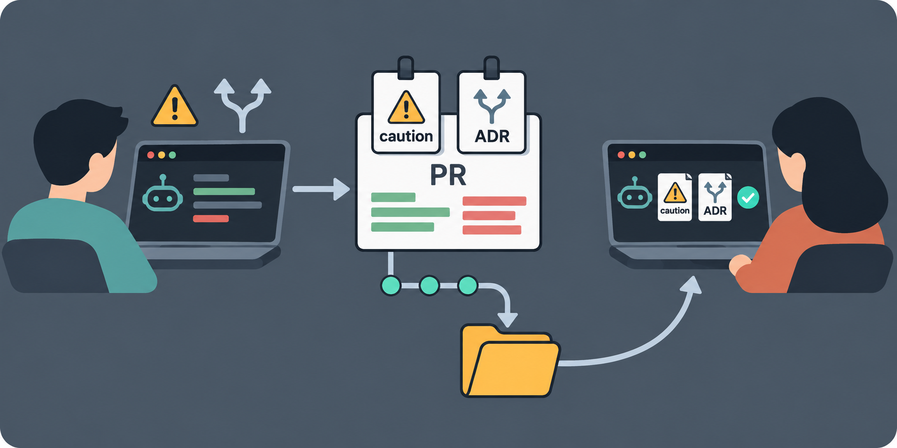
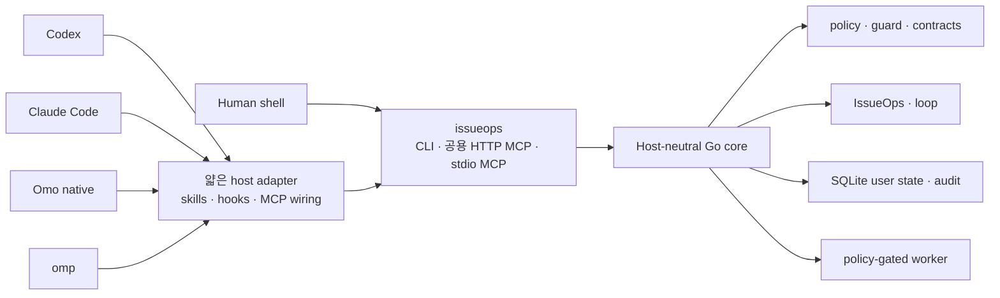

<h1 align="center">IssueOps</h1>

<p align="center">
  <strong>코딩 에이전트가 배운 것을 코드와 같은 PR에 남기는 팀의 기억</strong><br />
  한 사람의 에이전트가 알아낸 함정과 결정을 저장소에 기록하고,<br />
  다음 작업에서 팀원의 에이전트가 그 기록을 먼저 읽게 합니다
</p>

<p align="center">
  <a href="README.md"><strong>한국어</strong></a>
  ·
  <a href="README.en.md">English</a>
</p>

<p align="center">
  
</p>

코딩 에이전트와 일하다 보면 시간을 들여 겨우 찾아낸 함정이나 여러 대안을 비교해서 내린 결정이
생깁니다. 이런 내용은 보통 한 사람의 대화 기록에만 남아서, 팀원의 에이전트는 같은 함정에 다시
빠지고 이미 기각한 대안을 다시 제안합니다.

IssueOps는 이 내용을 caution(함정과 해결을 적은 주의 기록)과 ADR(설계 결정 기록)로 저장소에 남기는
로컬 Go 하네스입니다. 기록은 이슈 하나를 단위로 진행하는 **이슈 → 계획 → 구현 → 검증 → PR/MR → 정리**
사이클 안에서 작성합니다. 그래서 바뀐 코드와 같은 PR에 담겨 함께 리뷰를 받습니다. 계획에 적용되는
결정과 주의사항 섹션이 없으면 계획이 통과하지 않고, 문서 반영 판정을 남기지 않으면 PR을 발행할 수
없습니다.

[팀 지식이 이어지는 방식](#팀-지식이-이어지는-방식) · [이슈가 하는 일](#이슈가-하는-일) ·
[사이클이 함께 맡는 일](#사이클이-함께-맡는-일) · [빠른 시작](#빠른-시작) · [첫 작업 시작](#첫-작업-시작) ·
[아키텍처](#아키텍처) · [문제 해결](#문제-해결)

## 팀 지식이 이어지는 방식

에이전트가 작업하다 함정을 만나면 caution을, 결정을 내리면 ADR을 한 건씩 `.issueops/cautions/`와
`.issueops/adr/`에 남깁니다. 기록은 마크다운 파일이라 코드와 함께 커밋되고 PR에서 리뷰를 받습니다.
팀원이 `git pull`로 기록을 받으면, Codex, Claude Code, Omo native, omp 중 어느 호스트를 쓰든 같은
기록을 읽습니다. 맨 위 그림이 이 흐름입니다. 그림에 없는 단계가 둘 있습니다. 팀원의 에이전트는
기록 전체가 아니라 `route-docs`가 작업에 맞춰 고른 기록만 읽고, 그 작업에서 새로 알게 된 것도 다시
기록으로 남깁니다. 그래서 기록은 작업이 거듭될수록 쌓입니다.

### 실제 기록과 조회 예

이 저장소도 [`.issueops/cautions/`](.issueops/cautions/)와 [`.issueops/adr/`](.issueops/adr/)에
기록을 쌓으며 개발합니다. 그중 caution 하나를 예로 듭니다.
[`2026-08-28-gitlab-workitem-labels-...`](.issueops/cautions/2026-08-28-gitlab-workitem-labels-assignees-selection-create-child-glab.md)는
GitLab WorkItem이 labels·assignees를 위젯으로만 노출해서 `remote create-child`가 실패했고,
가짜 `glab` 스텁이 잘못된 응답을 그대로 돌려줘 테스트는 계속 통과했다는 기록입니다. 이 기록에는
`Summary`, `Context`, `Resolution`, `Evidence` 항목이 있어서 무엇이 왜 깨졌고 어떻게 고쳤는지를
읽을 수 있습니다.

나중에 GitLab 하위 이슈를 건드리는 작업을 시작하면 `route-docs`가 이 기록을 골라 줍니다.
아래는 실제 출력의 `docs` 배열 중 해당 항목이며, 절대 경로인 `path` 필드만 뺐습니다.

```bash
io project route-docs --repo . --task "gitlab child issue labels" --json
```

```json
{
  "rel_path": ".issueops/cautions/2026-08-28-gitlab-workitem-labels-assignees-selection-create-child-glab.md",
  "reason": "past record \"GitLab WorkItem 직속 labels/assignees selection이 create-child를 막았고 가짜 glab 스텁이 그 오류를 감췄다\" shares: child, gitlab, label",
  "exists": true
}
```

### 기록이 빠지지 않게 하는 장치

기록을 남기는 일과 찾아 읽는 일을 사람의 기억에 맡기지 않습니다.

| 시점 | 장치 | 동작 |
|---|---|---|
| 기록 | `project append` (MCP `project_docs_append`) | 날짜가 붙은 기록 한 건을 `.issueops/cautions/` 또는 `.issueops/adr/`에 추가합니다 |
| 작업 시작 | `project route-docs` (MCP `project_docs_route`) | 작업 설명과 단어가 두 개 이상 겹치는 과거 기록을 최대 다섯 건 고르고, 겹친 단어를 함께 돌려줍니다 |
| 계획 | `link-plan` 게이트 | 계획에 `## 적용되는 결정과 주의사항` 섹션이 없으면 거부합니다 |
| 문서 반영(6단계) | `project-docs-review record` 게이트 | 문서를 고쳤는지, 읽어 보고 바꿀 것이 없다고 판단했는지를 변경 집합의 fingerprint에 묶어 남깁니다 |

계획 단계의 `issueops-plan` 스킬은 route-docs로 고른 문서를 읽고, 이번 작업에 적용되는 결정과
주의사항을 그 섹션에 적습니다. 문서 반영 판정을 남긴 뒤에 diff가 바뀌면 판정이 무효가 되어 6단계로
돌아갑니다. 자세한 규칙은 [규칙을 지키게 하는 세 층](#규칙을-지키게-하는-세-층)에 있습니다.

`route-docs`는 의미 검색이 아니라 단어가 겹치는 정도로 기록을 고릅니다. 결과에는 고른 이유(겹친
단어)가 그대로 나옵니다. 다만 관련 기록을 찾으려면 작업 설명에 건드릴 파일과 동작을 구체적으로 적어야
합니다. 기록이 나중에 코드와 어긋나도 IssueOps가 이를 자동으로 찾아내지는 않습니다. 낡은 기록은 문서
반영 단계나 PR 리뷰에서 사람이 고쳐야 합니다.

### `AGENTS.md`, 에이전트 메모리와 무엇이 다른가요?

|  | `AGENTS.md`·`CLAUDE.md` | 에이전트 자체 메모리 | IssueOps 기록 |
|---|---|---|---|
| 누가 쓰나요 | 사람이 직접 | 에이전트가 대화를 보고 스스로 | 에이전트가 쓰고, 사람이 PR에서 리뷰 |
| 어디에 남나요 | 저장소의 파일 하나 | 각자의 컴퓨터 | 저장소의 `.issueops/`, 기록 한 건당 파일 하나 |
| 팀원에게 전달되나요 | git으로 전달 | 전달되지 않음 | git으로 전달 |
| 에이전트가 무엇을 읽나요 | 세션을 시작할 때 파일 전체 | 도구가 정한 범위 | 작업과 관련된 기록만 |
| 언제 쓰나요 | 누군가 떠올렸을 때 | 도구가 판단했을 때 | 알게 된 즉시, 늦어도 문서 반영 단계에서 |

에이전트 자체 메모리 열은 Claude Code의 자동 메모리를 기준으로 했습니다.
[Claude Code 공식 문서](https://code.claude.com/docs/en/memory)는 자동 메모리가 컴퓨터마다 따로
저장되고 다른 컴퓨터와 공유되지 않는다고 설명합니다. 같은 문서는 `CLAUDE.md`를 200줄 이하로 유지하라고
권하는데, 파일이 길수록 컨텍스트를 더 쓰고 지시를 덜 따르기 때문입니다.

IssueOps는 `AGENTS.md`를 대체하지 않습니다. bootstrap이 `AGENTS.md`에 문서 안내 블록을 넣고, 저장소
공통 규칙은 계속 `AGENTS.md`와 `.issueops/` 운영 문서에 둡니다. 세션마다 읽어야 할 규칙은
`AGENTS.md`에, 특정 작업에서만 필요한 함정과 결정은 기록으로 나눠 두는 방식입니다.

### 사이클 없이 쓰기

[첫 작업 시작](#첫-작업-시작)의 bootstrap을 마친 저장소라면 기록과 조회만 따로 쓸 수 있습니다.

```bash
io project append --repo . --kind caution \
  --title "Stripe webhook retries reuse the event id" \
  --summary "Deduplicate webhook handling by event id" --json
git add .issueops && git commit -m "docs: record webhook caution"

# 팀원의 체크아웃에서
io project route-docs --repo . --task "fix payment webhook retry handling" --json
```

### 팀이 공유하는 것과 각자 남는 것

| 구분 | 내용 | 위치 |
|---|---|---|
| 팀이 공유 | 운영 문서, caution·ADR 기록 | 저장소의 `AGENTS.md`와 `.issueops/`. git으로 공유합니다 |
| 각자 로컬 | 사이클 진행 상태, 검증 근거 | `~/.local/state/issueops/`의 SQLite 저장소 |
| 각자 로컬 | 스킬 링크, MCP·hook 설정 | 사용자 홈의 호스트 설정. 설치할 때 만들어집니다 |

## 이슈가 하는 일

IssueOps의 Issue는 작업 단위인 이슈를 뜻합니다. 사이클 하나는 이슈 하나에서 시작하고, 브랜치와 계획,
PR, 머지 후 결과 보고가 모두 그 이슈 번호에 묶입니다. caution과 ADR이 무엇을 배웠는지를 남긴다면,
이슈는 무엇을 하려 했고 어디까지 끝냈는지를 남깁니다.

| 시점 | 이슈와 연결되는 것 |
|---|---|
| 시작 | `issueops-create-issue`가 조사와 확인 질문으로 요구사항을 정한 뒤 이슈를 만듭니다. 구현 이슈 본문에는 `요약`, `배경`, `완료 기준`, `범위`, `검증` 섹션이 있어야 합니다 |
| 브랜치 | `<이슈 번호>-<slug>` 이름으로 만듭니다. GitHub에서는 linked branch로 이슈에 연결하고, GitLab에서는 이 이름 규칙으로 연결합니다 |
| 계획 | 계획 검토의 진행 흐름이 이슈 본문의 관리 영역에 한 줄로 표시됩니다 |
| 구현 | 계획·의도·명세·계획 검토 사본(`plan.md`, `intent.md`, `spec.md`, `plan-review.md`)을 `.issueops/issues/<n>/`에 커밋합니다. 명세와 계획 검토 사본은 해당 자료가 있을 때만 생깁니다 |
| 발행 | 이슈에 연결된 브랜치에서 PR을 만들고, caution·ADR 기록이 코드와 함께 담깁니다 |
| 머지 후 | 사람이 쓴 진행 결과를 이슈 본문에 반영하고 이슈를 닫습니다 |

이슈 본문은 팀원이 읽는 문서라서 요약을 먼저 쓰고 짧게 유지합니다. 해시나 계획 전문 같은 구현 자료는
본문에 넣지 않고 `.issueops/issues/<n>/`에 둡니다
([관련 ADR](.issueops/adr/2026-09-24-issue-and-pr-bodies-are-human-documents.md)). 기록의 `Source:`
줄에 이슈 번호를 적어 두면, 그 ADR의 `Source: IssueOps #513`처럼 팀원이 기록에서 이슈로, 이슈에서
`.issueops/issues/<n>/`의 계획으로 거슬러 올라갈 수 있습니다.

작업이 크면 하위 이슈로 나눕니다. 하위 이슈는 각자 사이클을 거치고, 부모 사이클이 결과를 받아들이거나
(`child accept`) 거절합니다(`child reject`).

## 사이클이 함께 맡는 일

같은 사이클은 Codex, Claude Code, Omo native, omp 중 어느 호스트에서 이어받아도 같은 실행 계약과
규칙으로 진행됩니다. 네 호스트는 공통 CLI·MCP·스킬을 쓰고, 작업 상태와 검증 근거는 호스트 밖 로컬
SQLite에 남습니다. 기록을 읽고 남기게 하는 게이트 말고도 IssueOps는 다음 일을 처리합니다.

- **세션을 바꿔도 이어서 작업:** 연결된 이슈·브랜치·worktree·계획과 다음 단계를 조회합니다.
- **검증한 변경만 발행:** 리뷰와 문서 판정을 변경 집합의 fingerprint에 묶어, 수정 뒤에는 다시 검증하게 합니다.
- **중복 실행과 원격 생성 방지:** 실행 권한(lease), 세대 번호, CAS로 변경 주체를 확인하고 응답이 불분명하면 복구 절차로 안내합니다.
- **호스트 간 규칙 공유:** `skills/` 원본과 `.issueops/` 운영 문서를 Codex·Claude Code·Omo native·omp에서 함께 사용합니다.

PR/MR 발행 완료, 머지, 정리는 별도 단계입니다. 에이전트는 사용자가 요청한 범위까지
진행하며, 발행만 요청한 작업을 임의로 머지하거나 삭제하지 않습니다.

### 규칙을 지키게 하는 세 층

규칙은 어겼을 때 드는 비용에 따라 세 층으로 나눕니다.

| 층 | 담는 것 | 예 |
|---|---|---|
| 문맥(hook) | 세션에 필요한 정적 정보. 상태를 읽거나 쓰지 않습니다 | `SessionStart`·`SubagentStart`가 `.issueops/` 문서 목록을 넣습니다 |
| 절차(스킬) | 판단이 필요한 순서와 기준. 어기면 리뷰에서 잡습니다 | 계획 전에 CONSTITUTION·CAUTIONS·ADR을 읽고 `## 적용되는 결정과 주의사항`에 적습니다 |
| 게이트(CLI) | 어기면 다음 단계가 막힙니다. fingerprint로 사이클 상태에 봉인합니다 | `link-plan`의 필수 섹션 검사, `project_docs_review` 발행 게이트 |

- `link-plan`은 `## 적용되는 결정과 주의사항`, `## 재사용하는 기존 구현`, `## 성능 영향`,
  `## 하위 호환성과 side effect` 네 섹션 중 하나라도 없으면 계획을 거부합니다.
- `project-docs-review record`의 `--verdict updated`는 `--doc`으로 적은 경로가 모두 실제 변경에
  있어야 하고, `--verdict no-change`는 실제로 읽은 `--reviewed-doc`(`.issueops/` 아래 문서나
  `AGENTS.md`)이 하나 이상 있어야 합니다.
- `devils-advocate review`는 계획 단계마다 면제 없는 `revise` 판정을 다섯 번까지만 받습니다. 여섯
  번째는 거부하고, 실제로 열려 있는 탈출 경로를 오류에 적습니다.

hook은 아무것도 강제하지 않습니다. 2026-08-27 결정으로 강제용 hook을 모두 없앴고, 단계를 알려 주는
hook은 단계 판정을 두 곳에 두게 되므로 채택하지 않았습니다. 근거는 [설계 결정](.issueops/ADR.md)에
있습니다.

## 빠른 시작

필수 환경은 **Git, Go 1.26.6 이상, 사용할 코딩 호스트 하나 이상**입니다. 아직 공개된 바이너리
릴리스가 없어 소스에서 빌드합니다(`v0.1.0`은 Draft 상태입니다). GitHub·GitLab에 이슈나 PR/MR을
쓰려면 해당 provider의 CLI(`gh`·`glab`)와 인증도 준비합니다. Orca, Herdr와 브라우저 QA용 Aside는
선택 연동이며 별도로 설치합니다. 스킬과 이슈·PR 템플릿은 현재 한국어로만 제공됩니다.

```bash
git clone https://github.com/m16khb-org/issueops.git
cd issueops

./install.sh --dry-run --json
./install.sh

./bin/issueops inspect --json
./bin/issueops doctor --repo . --json
```

> [!IMPORTANT]
> 현재 버전은 0.1.0입니다. 설치는 사용자 홈의 호스트 설정·스킬 링크와
> `~/.local/bin` 명령을 갱신합니다. 먼저 dry-run의 대상 경로를 확인하세요.
> `install.sh`는 dry-run에서도 로컬 바이너리를 빌드하고, 호스트 설정 쓰기만 생략합니다.

설치 뒤에는 정식 명령 `issueops` 또는 짧은 별칭 `io`를 사용합니다. 기존의 다른
`io`·`issueops` 파일을 덮어쓰지 않으며 충돌 시 설치를 중단합니다.

### 어디에 설치되나요?

| 대상 | 기본 위치와 역할 |
|---|---|
| Codex | `~/.codex/skills/`, MCP 설정, `SessionStart`·`SubagentStart` hook |
| Claude Code | `~/.claude/skills/`, user-scope MCP, `SessionStart`·`SubagentStart` hook |
| Omo native | `~/.omo/agent/skills/`, `~/.omo/mcp.json`, lifecycle extension |
| omp | `~/.omp/agent/skills/`, `~/.omp/agent/mcp.json`, `~/.omp/agent/extensions/issueops.js` |
| agy(Antigravity CLI) | `~/.gemini/config/skills/`, `~/.gemini/config/mcp_config.json`. 항상 stdio로 연결하고 hook은 없습니다 |
| MCP 서비스 | macOS LaunchAgent `io.issueops.mcp` 또는 Linux systemd user `issueops-mcp.service`. `http://127.0.0.1:47831/mcp` 하나를 Codex·Claude Code·Omo native·omp가 함께 씁니다 |
| 실행 상태 | `~/.local/state/issueops/` 아래 SQLite 저장소. `ISSUEOPS_STATE_DIR`로 격리 가능 |
| 프로젝트 지식 | 대상 저장소의 `AGENTS.md`·`.issueops/`. 명시적인 project bootstrap으로 생성 |

스킬은 복사하지 않고 이 체크아웃의 `skills/`를 참조합니다. 설치 후에도 체크아웃을 유지하세요.
기본 설치는 대상 프로젝트에 파일을 만들지 않습니다. `--project-local`을 명시하면 project MCP 설정을
씁니다. `.mcp.json`, `.omo/mcp.json`, `.omp/mcp.json`은 `--mcp-transport=stdio`일 때만 만들고, 기본
HTTP 연결에서는 사용자 홈의 항목을 그대로 씁니다. agy용 `.agents/mcp_config.json`은 연결 방식과
관계없이 씁니다. 스킬 링크는 어느 경우에도 사용자 홈에만 둡니다.

macOS와 Linux의 기본 MCP 연결은 공용 HTTP 서비스입니다(`--mcp-transport=http`). 설치기는
`~/.local/state/issueops/mcp-http/bearer`에 인증 토큰을 만들고, 네 호스트 설정의 issueops 항목만
URL과 `Authorization` 헤더로 바꾼 뒤 파일 권한을 0600으로 둡니다. 호스트 세션마다 `issueops mcp`를
따로 띄우려면 `./install.sh --mcp-transport=stdio`로 설치합니다. 서비스 상태는
`io mcp service status --json`으로 확인합니다. HTTP로 workspace 도구를 부르는 세션은 먼저
`io mcp authorize --workspace-root <repo> ...`로 권한 파일을 발급받고, 호출할 때 그 경로를
`authority_file`로 넘깁니다. 같은 OS 사용자의 프로세스는 이 파일들을 읽을 수 있으므로 신뢰 경계는
OS 사용자입니다.

설치 옵션과 선택적 upstream plugin·skill 준비는 [설치 가이드](.issueops/operations/install.md)를 참고하세요.

### 업데이트

IssueOps 소스 체크아웃에서 실행합니다.

```bash
git pull --ff-only
io update --dry-run --json
io update --json
io inspect --json
```

`io update`는 빌드할 IssueOps 체크아웃을 `ISSUEOPS_ROOT`, 현재 디렉터리에서 위로 찾은 체크아웃,
설치된 명령이 가리키는 체크아웃 순으로 정합니다. 그래서 다른 IssueOps 체크아웃 안에서 실행하면 그
체크아웃을 빌드합니다. `git pull`은 대신 실행하지 않습니다. HTTP 설치에서는 `io update`가 MCP 서비스를
멈추고 새 바이너리로 다시 띄운 뒤 `build_id`를 확인합니다. MCP 변경은 호스트가 서버를 다시 연결할 때
적용되므로, 업데이트 후에도 옛 도구가 보이면 MCP를 재연결하세요.

현재 배포 결정: 첫 릴리스는 tarball/manual archive로 내고, Homebrew는 재현성 검증과 롤백 기준을 충족한 뒤 도입하기로
했습니다. 설치 복구가 필요하면
[릴리스 재현성과 롤백 기준](.issueops/operations/release-reproducibility.md)을 따르세요.

## 첫 작업 시작

### 1. 대상 프로젝트에 운영 문서와 기록 저장소 연결

작업할 저장소로 이동한 뒤 생성 계획을 확인합니다.

```bash
cd /path/to/your-project
io project bootstrap --repo . --dry-run --json
io project bootstrap --repo . --json
io project route-docs --repo . --task "fix login session expiry in auth middleware" --json
```

bootstrap은 `AGENTS.md`의 문서 안내와 `.issueops/` 문서 모음을 준비합니다.
기존 문서를 통째로 덮어쓰지 않습니다. 최초 생성은 `project-docs-bootstrap`, 작업 중
갱신은 `project-docs-update`, 큰 문서의 분리는 `project-docs-optimize` 스킬이 담당합니다.
생성된 `AGENTS.md`와 `.issueops/`를 커밋해야 팀원도 같은 문서와 기록을 받습니다.

### 2. 에이전트에 작업 요청

에이전트에게 `issueops` 스킬을 쓰라고 하면서 원하는 결과, 제약, 어디까지 진행할지를 알려 줍니다.
예를 들면:

> issueops로 로그인 오류를 수정해줘. 만료된 세션에서 오류를 재현하고 테스트를 추가해줘.
> Draft PR을 만드는 데까지 진행해줘.

현재 단계는 `next`로 확인합니다. 이 명령은 읽기 전용입니다.

```bash
io next --json
io list --repo "$PWD" --json
```

사이클이 없으면 `next`가 시작 명령을 안내합니다. 직접 시작하려면:

```bash
io start --repo "$PWD" --branch "123-fix-login" --json
io next --id "반환된-ID" --json
```

`next`의 `missing`, `next_command`, `exits`를 따라 진행합니다. `start --new`는 호출할 때마다
브랜치 없는 새 사이클을 만들므로, 응답이 불분명해도 다시 호출하지 않습니다. 원격 생성 결과가
불분명할 때도 재시도하지 말고 `remote reconcile-issue`·`remote reconcile-child`로 기존 결과를
확인합니다.

### 3. 단계별로 실행·검증·발행

| 단계 | 스킬 | 결과 |
|---|---|---|
| 1. 이슈 확정·생성 | `issueops-create-issue` | 요구사항·완료 기준을 담은 이슈 |
| 2. 브랜치 준비 | `issueops-prepare` | base SHA와 이슈에 연결된 브랜치 |
| 3. 계획·검토·인계 | `issueops-plan` | 관련 caution·ADR을 반영해 검토한 계획과 실행 worktree·세션 |
| 4. 구현 | `issueops-implement` | 테스트로 확인한 구현 |
| 5. AI slop 정리 | `issueops-slop-clean` | 불필요한 변경을 제거하고 봉인한 diff |
| 6. 문서 반영 | `issueops-docs` | 현재 구현과 일치하는 운영 문서, 이번 작업에서 나온 caution·ADR 기록 |
| 7. 검증 | `issueops-verify` | 실행 증거·독립 리뷰·발행 준비 확인 |
| 8. 커밋·푸시 | `atomic-commit-push` | 검증한 변경의 커밋과 원격 브랜치 |
| 9. PR/MR 발행·완료 | `issueops-create-pr`, `issueops-complete` | Draft PR/MR과 완료 증거 |
| 10. 머지·정리 | `issueops-merge`, `issueops-cleanup` | 머지한 PR/MR과 연결 이슈·worktree·브랜치 정리 |

이 표는 사용자용 단계입니다. 내부 저장 상태와의 대응은
[실행 가이드](.issueops/operations/guides/issueops-execution.md)가 설명합니다.
중간에 보류하거나 폐기하려면 `issueops-abandon`을 사용합니다.

release처럼 계속 앞서 나가는 base 브랜치에서 딴 작업 브랜치는 `sync-base` 스킬로
최신 상태에 맞춥니다. 이 스킬은 커밋이 이미 다른 브랜치에 들어갔는지, 다른 사람의 커밋이나
리뷰가 있는지를 확인해 merge와 rebase 중 하나를 고르고, 판단할 근거가 부족하면 merge를
선택합니다. IssueOps 사이클이 소유한 브랜치는 이 스킬 대신 `issueops execution sync-base`로
base 변경을 반영합니다.

## 모델과 세션 인계

구현에 들어가기 전에 실행 세션을 자동으로 정합니다. 준비 세션이 Herdr 세션이면 Herdr로 먼저
인계합니다. 그 밖에는 Orca가 준비되어 있으면 같은 worktree의 새 세션으로 인계하고, Orca를 쓸 수
없으면 Herdr를, 둘 다 쓸 수 없으면 현재 세션에서 이어 갑니다. cmux는 사용자가 지정했을 때만
씁니다. 사용자가 지정한 세션·보류·종료점이 이 자동 선택보다 우선합니다.

역할별 model·effort는 네 호스트 모두 사용자 전체(global)나 저장소 하나(local) 단위로 바꿀 수
있습니다. 우선순위는 필드마다 명시 플래그 > local > global > 기본값입니다.

```bash
issueops model show --json                                   # 현재 값과 출처
issueops model set --scope local --host codex --role diff-review --effort xhigh --json
issueops model resolve --host claude --role research --json  # 최종 값과 빈 컨텍스트 실행 argv
```

호스트별 기본값 표, 설정 파일 위치, 서브에이전트 역할과 리뷰 라운드에 따른 상향 규칙은
[실행 가이드의 역할별 모델 기본값과 설정](.issueops/operations/guides/issueops-execution.md#역할별-모델-기본값과-설정)에
있습니다. 대화로 바꾸려면 [`io-model`](skills/io-model/SKILL.md) 스킬을 씁니다.

자동 인계 명령은 Claude Code에 `--dangerously-skip-permissions`, Codex에
`--dangerously-bypass-approvals-and-sandbox`, Omo native에 `--permission-preset full-access`,
omp에 `--auto-approve`를 전달합니다. 호스트의 권한 확인을 생략하는 옵션이므로 인계할 작업 범위를
먼저 정하세요. IssueOps 자체의 실행 권한·세대·workspace·원격 쓰기 검사는 유지됩니다. 인계 명령의
수락과 실제 owner claim·작업 완료는 각각 다른 증거로 기록합니다.

## 아키텍처

<p align="center">
  
</p>



DDD 관점에서 **업무 규칙과 상태 전이는 domain**, **실행 순서와 트랜잭션 조율은 application**이
담당합니다. 파일·DB·Git·프로세스 같은 기술 구현은 adapter에 두고 composition root에서 연결합니다.

| 경로 | 책임 |
|---|---|
| `cmd/issueops/` | 의존성 조립과 CLI·MCP·hook 진입점 |
| `internal/contract/` | 버전이 있는 DTO와 응답·저장 계약 |
| `internal/domain/` | I/O 없는 업무 규칙·상태 전이·판정 |
| `internal/application/` | domain·port를 조합하는 실행 흐름 |
| `internal/port/` | 외부 기능의 인터페이스와 오류 계약 |
| `internal/adapter/` | 호스트·파일·DB·Git·프로세스 구현 |
| `internal/architecture/` | 계층 의존성·소유권 회귀 검사 |
| `skills/`, `configs/` | 공용 스킬 원본과 호스트 설정 템플릿 |
| `.issueops/` | 아키텍처·운영·검증·ADR 문서 |

MCP는 기본적으로 사용자당 하나만 뜨는 로컬 HTTP 서비스에서 실행되고, stdio로 설치하면
호스트 세션 안에서 실행됩니다. hook은 프로젝트 문서 문맥을 제공하고,
작업 실행이나 단계 판정을 대신하지 않습니다. 작업 단계는 `next`, 변경 허용 여부는
CLI 게이트가 담당합니다. 상세 경계는 [아키텍처 문서](.issueops/ARCHITECTURE.md)를 참고하세요.

### 안전 경계

- 원격 쓰기는 명시적 승인과 해당 명령의 fingerprint·actor 계약을 따릅니다.
- 명령 실행에는 workspace·cwd 경계, 쓰기·네트워크 의도, timeout과 secret redaction을 적용합니다.
- MCP 도구 인자는 공개 스키마로 검증하며, 모르는 필드나 빠지거나 타입이 틀린 필드는 거부합니다.
- secret 원문은 문서, 상태 응답, 감사 로그, 테스트 fixture에 남기지 않습니다.
- 외부 도구의 설치나 인증은 해당 도구의 공식 절차로 별도 준비합니다. Orca 같은 연동은 선택 사항이며,
  기본 설치·준비 상태 확인·자기 검증은 외부 도구를 요구하지 않습니다.

## 검증과 일상 진단

```bash
io status --json
io doctor --repo . --json
io docs --json
io contract check --json
```

하네스 소스를 수정했다면 [검증 기준](.issueops/TESTING.md)에 따라 테스트합니다.
자기 검증의 진행 상황은 `--progress=jsonl`로 확인할 수 있습니다.

```bash
io self-verify --seed=100 --target-score=95 --llm-eval=false --progress=jsonl --json
io quality inspect --json
```

`self-verify`는 테스트·빌드·CLI/MCP·설치·동시성 등 검증 단계를 실행합니다.
`quality inspect`는 커버리지와 복잡도 등 개선 후보를 수집하며, 캐시가 없으면 전체 Go 커버리지
테스트를 실행하므로 시간이 걸릴 수 있습니다. 수집 성공(`collection_status`), 관찰된 상태
(`health_status`), 차단 여부(`gate_status`)를 구분해 읽으세요.

전체 명령과 공개 도구 계약은 `io --help`, `io contract schema --json`으로 확인합니다.
스킬별 절차는 [`skills/`](skills/)의 각 `SKILL.md`가 정규 원본입니다.

## 문제 해결

| 증상 | 확인할 내용 |
|---|---|
| 설치 후 `io`를 찾지 못함 | 새 셸을 열고 `~/.local/bin`이 PATH에 있는지 확인 |
| 기존 명령 파일 때문에 설치 거부 | `--dry-run --json`에서 충돌 경로 확인. 기존 파일은 자동으로 덮어쓰지 않음 |
| 업데이트 후에도 옛 MCP 도구가 보임 | 호스트 MCP 재연결 후 `io inspect --json` 확인 |
| 단계가 막혔거나 다음 작업이 불분명함 | `io next --id <ID> --json`의 `missing`·`next_command` 확인 |
| 문서 판정 후 이전 단계로 돌아감 | diff 변경으로 fingerprint가 달라졌는지 확인하고 문서 검토·재봉인 |
| 인계 모델이나 effort가 예상과 다름 | `io model show --json`의 값과 출처, 명시한 `--owner-model`·`--owner-effort`, 리뷰 라운드 확인 |
| self-verify가 오래 걸림 | `--progress=jsonl`로 실행 중인 단계 확인 |
| 설치·상태 저장소에 문제가 있음 | `io doctor --repo . --json`로 항목별 진단 |

## 더 알아보기

| 문서 | 용도 |
|---|---|
| [AGENTS.md](AGENTS.md) | 저장소 작업 규칙과 검증 우선순위 |
| [운영 가이드](.issueops/OPERATIONS.md) | 설치·호스트·CLI/MCP·상태 운영 |
| [실행 가이드](.issueops/operations/guides/issueops-execution.md) | 사이클·실행 권한·인계·복구·역할별 모델 |
| [아키텍처](.issueops/ARCHITECTURE.md) | 계층별 책임과 의존 방향 |
| [작업 흐름](.issueops/AGENT_WORKFLOW.md) | 에이전트의 시작·검증·완료 절차 |
| [테스트 기준](.issueops/TESTING.md) | 변경 종류별 검증과 완료 조건 |
| [설계 결정](.issueops/ADR.md) | 채택한 결정과 근거 |
| [릴리스·롤백](.issueops/operations/release-reproducibility.md) | 빌드 산출물 검증과 설치 복구 |

## 라이선스

MIT. [LICENSE](LICENSE).
